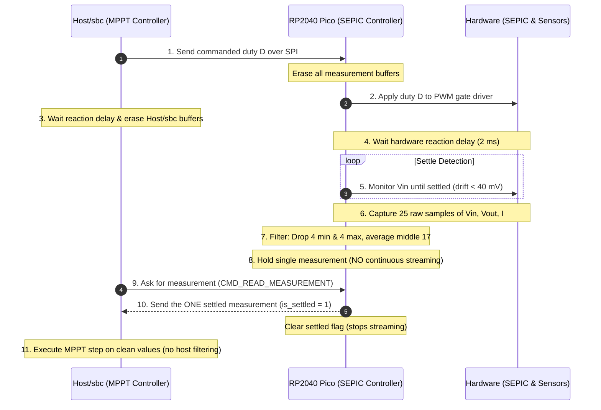

# MPPT measurement protocol

How one closed-loop measurement works, and why it works this way.

## Why: stale telemetry makes the voltage drift up

Early bench runs of P&O, Incremental Conductance and Fuzzy Logic drifted to
voltages above $V_\text{mpp}$, up to $V_\text{oc}$. The cause:

1. The SPI bus is full-duplex. The Pico loads the 12-byte MISO frame into
   its TX FIFO before the transaction. So the telemetry that comes back
   with `write(D_k)` shows the state under $D_{k-1}$ or earlier.
2. On a SEPIC, a higher duty $D$ lowers the panel voltage
   ($R_\text{in} = R_\text{load}((1-D)/D)^2$). A lower $D$ raises it toward
   $V_\text{oc}$.
3. The algorithm raises $D$ and reads stale data where the voltage has not
   dropped yet. It sees the wrong slope $\mathrm{d}P/\mathrm{d}V$ (or the
   wrong conductance increment) and flips to lower $D$. Repeated flips push
   the voltage up to $V_\text{oc}$.

The fix is a strict request-response sequence with one settled measurement
per duty.

## Sequence

### Steps

1. The Host/sbc sends the duty $D$ over SPI (`write(D)`).
2. The Pico zeroes all measurement registers (`MEAS_V_MV`, `MEAS_I_MA`,
   `MEAS_ADC_VOUT_MV`, ...), clears `DUTY_SETTLED` and updates the PWM
   compare register.
3. The Host/sbc waits at least $5 - 10\,\text{ms}$ and flushes its local
   telemetry cache and SPI input buffers.
4. The Pico waits $2\,\text{ms}$ for the SEPIC inductors and coupling
   capacitors to start the transition.
5. The Pico watches $V_\text{in}$ in an 8-sample rolling window until the
   drift is below $40\,\text{mV}$ (ceiling $80\,\text{ms}$).
6. The Pico takes 25 consecutive readings of $V_\text{in}$, $V_\text{out}$
   and $I$. For each channel it sorts them, drops the 4 lowest and the 4
   highest, and averages the middle 17.
7. The Pico stores the result in `MEAS_*`, sets `DUTY_SETTLED = true` and
   parks. It runs no background sampling and does not overwrite the result
   with raw 1 ms readings.
8. The Host/sbc sends `_CMD_READ_MEASUREMENT` (`0x02`).
9. The Pico returns the one settled frame with `is_settled = 1` and clears
   `DUTY_SETTLED`.
10. The algorithm uses the values as they are. The host does no filtering
    or averaging.

Implementation notes:

- The 2 ms delay is `Timer::after_millis(2).await` in `onchip_adc_task`,
  started by `MEAS_TRIGGER_COUNT`.
- The settle check ends by asserting `SETTLED_TRIGGER`.
- The filter averages `samples[4..21]` on the INA229 and ADC channels.
- `sensors_task` and `onchip_adc_task` run only on a trigger in MPPT mode.
  The raw 1 kHz loop is off.

---

## Filter Specification (25-Sample Trimmed Mean)

Let $S = [s_0, s_1, \dots, s_{24}]$ be an array of 25 consecutive ADC readings for a given channel
($V_{\text{in}}$, $V_{\text{out}}$, or $I$):

1. **Sort**: $$S_{\text{sorted}} = \text{sort}(S)$$
2. **Trim Outliers**:
   - Discard $S_{\text{sorted}}[0 \dots 3]$ (4 lowest)
   - Discard $S_{\text{sorted}}[21 \dots 24]$ (4 highest)
3. **Compute Average**: $$\bar{S} = \frac{1}{17} \sum_{k=4}^{20} S_{\text{sorted}}[k]$$
