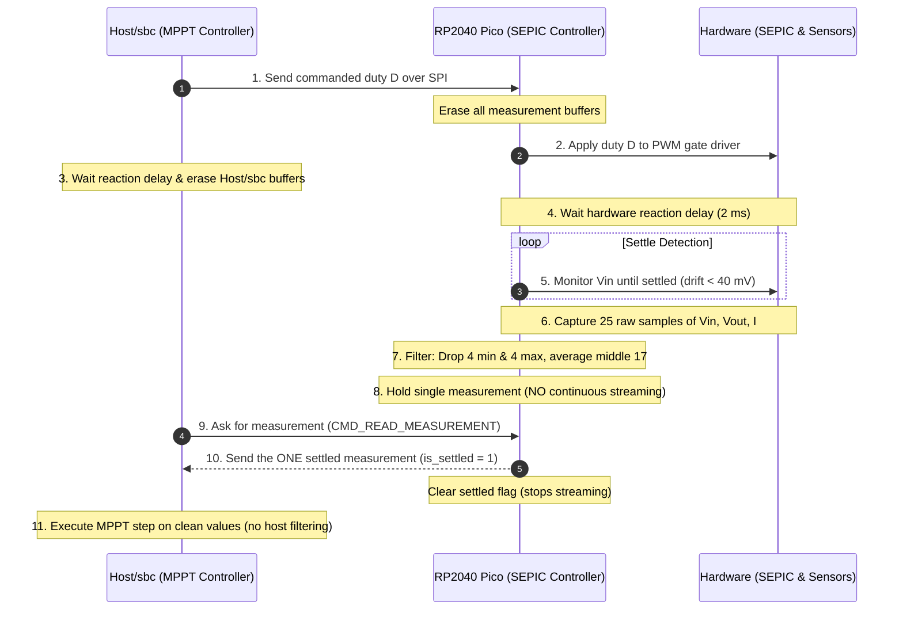

# MPPT Measurement Protocol & Closed-Loop Telemetry Flow

## 1. Problem Statement: Higher Voltage Drift ($V > V_{\text{mpp}}$)

During bench tests with MPPT algorithms (such as Perturb & Observe, Incremental Conductance, and
Fuzzy Logic), algorithms were observed drifting towards higher terminal voltages than the Maximum
Power Point (MPP), eventually climbing towards open-circuit voltage ($V_{oc}$).

### Root Cause Analysis

1. **Full-Duplex SPI Pipelining Delay**:

   - The SPI bus operates in full-duplex. When the Host/sbc clocks out a 12-byte MOSI packet
     containing a new duty cycle $D_{k}$, the Pico simultaneously clocks out a 12-byte MISO packet
     that was loaded into the TX FIFO **prior to the transaction**.
   - Consequently, the telemetry received during `source.write(D_k)` reflects the state under the
     previous duty cycle $D_{k-1}$ (or earlier).

2. **SEPIC Dynamics & Sign Inversion**:

   - On a SEPIC converter, reflected input resistance is given by:
     $$R_{\text{in}} = R_{\text{load}} \left(\frac{1 - D}{D}\right)^2$$
   - Raising duty $D$ **decreases** panel voltage $V_{\text{in}}$ (pulling more current).
   - Lowering duty $D$ **increases** panel voltage $V_{\text{in}}$ towards $V_{oc}$.

3. **Inverted Perturbation Feedback**:
   - If the algorithm increases $D$ to drop the voltage towards $V_{\text{mpp}}$, but immediately
     reads stale telemetry where the voltage hasn't dropped yet, it miscalculates power slope
     $\frac{\mathrm{d}P}{\mathrm{d}V}$ or conductance increment
     $\frac{\mathrm{d}I}{\mathrm{d}V} + \frac{I}{V}$.
   - The algorithm incorrectly deduces that increasing $D$ did not yield the expected power change,
     flipping its perturbation direction to decrease $D$.
   - Decreasing $D$ drives the SEPIC switch towards 0% duty, which raises the panel voltage all the
     way to $V_{oc}$.

---

## 2. Expected System Behavior (Single-Measurement on Demand)

To prevent cross-talk between duties and eliminate noise from continuous streaming, the measurement
flow follows a strict request-response sequence:

### Detailed Sequence Steps

1. **Host/sbc sends a duty to Pico**: The Host/sbc calculates the next duty cycle $D$ and sends it
   to the Pico via SPI (`write(D)`).

2. **Pico sets that duty and erases all buffers**: The Pico receives the duty, immediately zeroes
   all measurement registers (`MEAS_V_MV`, `MEAS_I_MA`, `MEAS_ADC_VOUT_MV`, etc.), clears
   `DUTY_SETTLED`, and updates the hardware PWM compare register.

3. **Host/sbc has a small delay and erases buffers**: The Host/sbc waits a settling window
   ($\ge 5-10\,\text{ms}$) and explicitly flushes its local telemetry cache and SPI input buffers so
   no cross-talk or stale measurements can leak across duties.

4. **Pico waits the hardware reaction delay**: The Pico waits $2\,\text{ms}$ to allow the SEPIC
   inductors and coupling capacitors to begin transitioning.

5. **Pico checks if Vin is settled**: The Pico monitors $V_{\text{in}}$ across an 8-sample rolling
   window until drift is $< 40\,\text{mV}$ (up to $80\,\text{ms}$ ceiling).

6. **Pico performs 25-sample filtered measurement**: Once steady state is reached, the Pico takes
   **25 consecutive readings** of $V_{\text{in}}$, $V_{\text{out}}$, and $I$:

   - For each channel, the 25 readings are sorted.
   - The **4 lowest** and **4 highest** outliers are discarded ($25 - 8 = 17$ samples remaining).
   - The remaining **17 samples** are averaged (trimmed mean filter).

7. **Pico holds the single measurement (NO streaming)**: The Pico stores the filtered mean into
   `MEAS_*`, asserts `DUTY_SETTLED = true`, and **parks**. The firmware does **not** run background
   sampling loops and does **not** overwrite the filtered result with 1 ms raw readings.

8. **Host/sbc asks for a measurement**: Host/sbc sends `_CMD_READ_MEASUREMENT` (`0x02`) over SPI.

9. **Pico sends the ONE measurement to the Host/sbc**: The Pico returns the single settled
   measurement frame with `is_settled = 1`. Upon delivery, Pico clears `DUTY_SETTLED = false` so it
   does not stream further data.

10. **Host/sbc analyzes measurements without filtering**: The Host/sbc / MPPT algorithm consumes the
    validated measurement directly, evaluating $\Delta P$ and $\Delta V$ with zero host-side
    filtering or averaging loops.

---

## 3. Implementation Comparison

| Step                      | Expected Implementation                                                                                        | Current Implementation                                                                                                            | Old Implementation                                                                                                       |
| ------------------------- | -------------------------------------------------------------------------------------------------------------- | --------------------------------------------------------------------------------------------------------------------------------- | ------------------------------------------------------------------------------------------------------------------------ |
| **Duty Application**      | Duty is sent; old buffers erased on Pico and Host/sbc.                                                         | `write(D)` transmits duty; Pico zeroes `MEAS_*` and sets `DUTY_SETTLED = false`; Host/sbc zeroes local cache.                     | Sent via SPI; MISO telemetry returned in the _same_ frame was consumed immediately (reading stale data from prior duty). |
| **Pico Hardware Delay**   | Pico applies initial reaction delay (2 ms) after duty cycle change.                                            | `Timer::after_millis(2).await` in Pico firmware `onchip_adc_task` triggered by `MEAS_TRIGGER_COUNT`.                              | Handled by arbitrary Linux-side `time.sleep(0.002)` in Python driver.                                                    |
| **Settling Verification** | Dynamic $V_{\text{in}}$ stability check (drift $< 40\,\text{mV}$) before sampling.                             | 8-sample rolling window in Pico evaluating $\Delta V < 40\,\text{mV}$ (up to $80\,\text{ms}$) before asserting `SETTLED_TRIGGER`. | Python-side rolling buffer polling over SPI subject to Linux scheduling jitter.                                          |
| **Sample Filtering**      | **25 samples taken; 4 lowest and 4 highest removed (averaging 17).**                                           | **25 samples taken on INA229 & ADC; sorted; `samples[4..21]` averaged ($\mathbf{N=17}$).**                                        | 10 samples taken in firmware (averaging 6), or host-side list sorting in Python.                                         |
| **Continuous Streaming**  | **Disabled:** Pico holds the single filtered reading; does NOT overwrite with raw samples.                     | `sensors_task` and `onchip_adc_task` are strictly trigger-based in MPPT mode; raw 1 kHz loop disabled.                            | Tasks ran free-running 1 ms loops overwriting filtered values with raw 1-sample noisy readings immediately.              |
| **Telemetry Delivery**    | On-demand: Host/sbc asks via `CMD_READ_MEASUREMENT`; Pico returns the one measurement and clears settled flag. | Host/sbc `read()` waits delay, zeroes cache, queries `_CMD_READ_MEASUREMENT`; Pico delivers frame and clears `DUTY_SETTLED`.      | Desynchronized; host took whatever value was already sitting in MISO FIFO at exchange start.                             |
| **Host/sbc Processing**   | Clean host: Zero filtering or artificial delays on Host/sbc; consumes values directly.                         | Clean host: Zero filtering in Python; algorithms consume clean $(V, I)$ directly.                                                 | Host ran its own sleep delays, dynamic drift checks, and list-filtering loops in Python.                                 |

---

## 4. Filter Specification (25-Sample Trimmed Mean)

Let $S = [s_0, s_1, \dots, s_{24}]$ be an array of 25 consecutive ADC readings for a given channel
($V_{\text{in}}$, $V_{\text{out}}$, or $I$):

1. **Sort**: $$S_{\text{sorted}} = \text{sort}(S)$$
2. **Trim Outliers**:
   - Discard $S_{\text{sorted}}[0 \dots 3]$ (4 lowest)
   - Discard $S_{\text{sorted}}[21 \dots 24]$ (4 highest)
3. **Compute Average**: $$\bar{S} = \frac{1}{17} \sum_{k=4}^{20} S_{\text{sorted}}[k]$$
