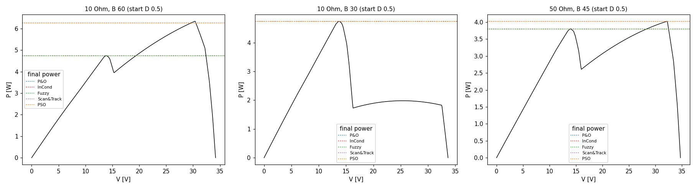

# Two-peak curves: algorithm comparison

Static simulation on measured curves. Not closed-loop bench runs.

- Each algorithm runs 2000 steps on a measured I-V curve (`MeasuredPanel` behind a simulated SEPIC).
- Curves are committed under `data/bench/`: B 60 and B 30 (10 Ohm session), B 45 (50 Ohm session).
- Start duty is 0.3, 0.5 and 0.7. Seeds are fixed (PSO seed 0).
- Efficiency is final power divided by the global peak of the curve.
- "Global peak" is yes if final power is at least 98 % of the global peak.
- "Steps" is the last step where power was more than 1 % from its final value.
  A value near 2000 means the algorithm never settled (it keeps scanning or dithering).
- Regenerate with `uv run python scripts/make_two_peak_results.py`.

## What this shows

On the 10 Ohm B 60 curve (peaks 4.75 W at 13.9 V and 6.35 W at 30.4 V), P&O, InCond and Fuzzy stop on the
local peak at 4.74 W (74.6 to 74.8 % of the global peak) from all three start duties. Scan&Track and PSO find
the global peak (98.7 and 98.8 %), but they do not settle inside 1 % in 2000 steps. On the B 30 curve the
second peak is weak (1.98 W against 4.74 W), so every algorithm ends at 100.0 %: it is not a real test. On the
50 Ohm B 45 curve the peaks are close (3.80 W and 4.03 W), so getting stuck costs only about 6 %. P&O, InCond
and Fuzzy find the global peak from start duty 0.3 but end on the local one (94.3 to 94.4 %) from 0.5 and 0.7.
Scan&Track and PSO find it from every start (100.0 and 99.9 %). Only one curve has a clear gap (B 60), so
this is a small sample. These are static simulations on measured curves, not closed-loop bench runs.

## Table

| Curve | Peaks | Algorithm | Start D | Final P [W] | Efficiency | Global peak | Steps |
|---|---|---|---|---|---|---|---|
| 10 Ohm, B 60 | 13.9 V, 4.75 W; 30.4 V, 6.35 W | P&O | 0.3 | 4.736 | 74.6 % | no | 13 |
| 10 Ohm, B 60 | 13.9 V, 4.75 W; 30.4 V, 6.35 W | P&O | 0.5 | 4.736 | 74.6 % | no | 84 |
| 10 Ohm, B 60 | 13.9 V, 4.75 W; 30.4 V, 6.35 W | P&O | 0.7 | 4.736 | 74.6 % | no | 184 |
| 10 Ohm, B 60 | 13.9 V, 4.75 W; 30.4 V, 6.35 W | InCond | 0.3 | 4.736 | 74.6 % | no | 13 |
| 10 Ohm, B 60 | 13.9 V, 4.75 W; 30.4 V, 6.35 W | InCond | 0.5 | 4.736 | 74.6 % | no | 84 |
| 10 Ohm, B 60 | 13.9 V, 4.75 W; 30.4 V, 6.35 W | InCond | 0.7 | 4.736 | 74.6 % | no | 184 |
| 10 Ohm, B 60 | 13.9 V, 4.75 W; 30.4 V, 6.35 W | Fuzzy | 0.3 | 4.745 | 74.7 % | no | 16 |
| 10 Ohm, B 60 | 13.9 V, 4.75 W; 30.4 V, 6.35 W | Fuzzy | 0.5 | 4.748 | 74.8 % | no | 122 |
| 10 Ohm, B 60 | 13.9 V, 4.75 W; 30.4 V, 6.35 W | Fuzzy | 0.7 | 4.745 | 74.7 % | no | 259 |
| 10 Ohm, B 60 | 13.9 V, 4.75 W; 30.4 V, 6.35 W | Scan&Track | 0.3 | 6.266 | 98.7 % | yes | 1999 |
| 10 Ohm, B 60 | 13.9 V, 4.75 W; 30.4 V, 6.35 W | Scan&Track | 0.5 | 6.266 | 98.7 % | yes | 1999 |
| 10 Ohm, B 60 | 13.9 V, 4.75 W; 30.4 V, 6.35 W | Scan&Track | 0.7 | 6.266 | 98.7 % | yes | 1999 |
| 10 Ohm, B 60 | 13.9 V, 4.75 W; 30.4 V, 6.35 W | PSO | 0.3 | 6.273 | 98.8 % | yes | 1999 |
| 10 Ohm, B 60 | 13.9 V, 4.75 W; 30.4 V, 6.35 W | PSO | 0.5 | 6.273 | 98.8 % | yes | 1999 |
| 10 Ohm, B 60 | 13.9 V, 4.75 W; 30.4 V, 6.35 W | PSO | 0.7 | 6.273 | 98.8 % | yes | 1999 |
| 10 Ohm, B 30 | 13.7 V, 4.74 W; 25.4 V, 1.98 W | P&O | 0.3 | 4.739 | 100.0 % | yes | 14 |
| 10 Ohm, B 30 | 13.7 V, 4.74 W; 25.4 V, 1.98 W | P&O | 0.5 | 4.739 | 100.0 % | yes | 83 |
| 10 Ohm, B 30 | 13.7 V, 4.74 W; 25.4 V, 1.98 W | P&O | 0.7 | 4.739 | 100.0 % | yes | 183 |
| 10 Ohm, B 30 | 13.7 V, 4.74 W; 25.4 V, 1.98 W | InCond | 0.3 | 4.739 | 100.0 % | yes | 14 |
| 10 Ohm, B 30 | 13.7 V, 4.74 W; 25.4 V, 1.98 W | InCond | 0.5 | 4.739 | 100.0 % | yes | 83 |
| 10 Ohm, B 30 | 13.7 V, 4.74 W; 25.4 V, 1.98 W | InCond | 0.7 | 4.739 | 100.0 % | yes | 183 |
| 10 Ohm, B 30 | 13.7 V, 4.74 W; 25.4 V, 1.98 W | Fuzzy | 0.3 | 4.740 | 100.0 % | yes | 17 |
| 10 Ohm, B 30 | 13.7 V, 4.74 W; 25.4 V, 1.98 W | Fuzzy | 0.5 | 4.740 | 100.0 % | yes | 119 |
| 10 Ohm, B 30 | 13.7 V, 4.74 W; 25.4 V, 1.98 W | Fuzzy | 0.7 | 4.740 | 100.0 % | yes | 256 |
| 10 Ohm, B 30 | 13.7 V, 4.74 W; 25.4 V, 1.98 W | Scan&Track | 0.3 | 4.739 | 100.0 % | yes | 25 |
| 10 Ohm, B 30 | 13.7 V, 4.74 W; 25.4 V, 1.98 W | Scan&Track | 0.5 | 4.739 | 100.0 % | yes | 25 |
| 10 Ohm, B 30 | 13.7 V, 4.74 W; 25.4 V, 1.98 W | Scan&Track | 0.7 | 4.739 | 100.0 % | yes | 25 |
| 10 Ohm, B 30 | 13.7 V, 4.74 W; 25.4 V, 1.98 W | PSO | 0.3 | 4.740 | 100.0 % | yes | 21 |
| 10 Ohm, B 30 | 13.7 V, 4.74 W; 25.4 V, 1.98 W | PSO | 0.5 | 4.740 | 100.0 % | yes | 21 |
| 10 Ohm, B 30 | 13.7 V, 4.74 W; 25.4 V, 1.98 W | PSO | 0.7 | 4.740 | 100.0 % | yes | 21 |
| 50 Ohm, B 45 | 14.1 V, 3.80 W; 32.2 V, 4.03 W | P&O | 0.3 | 4.027 | 100.0 % | yes | 1999 |
| 50 Ohm, B 45 | 14.1 V, 3.80 W; 32.2 V, 4.03 W | P&O | 0.5 | 3.797 | 94.3 % | no | 0 |
| 50 Ohm, B 45 | 14.1 V, 3.80 W; 32.2 V, 4.03 W | P&O | 0.7 | 3.797 | 94.3 % | no | 101 |
| 50 Ohm, B 45 | 14.1 V, 3.80 W; 32.2 V, 4.03 W | InCond | 0.3 | 4.027 | 100.0 % | yes | 1999 |
| 50 Ohm, B 45 | 14.1 V, 3.80 W; 32.2 V, 4.03 W | InCond | 0.5 | 3.797 | 94.3 % | no | 0 |
| 50 Ohm, B 45 | 14.1 V, 3.80 W; 32.2 V, 4.03 W | InCond | 0.7 | 3.797 | 94.3 % | no | 101 |
| 50 Ohm, B 45 | 14.1 V, 3.80 W; 32.2 V, 4.03 W | Fuzzy | 0.3 | 4.027 | 100.0 % | yes | 3 |
| 50 Ohm, B 45 | 14.1 V, 3.80 W; 32.2 V, 4.03 W | Fuzzy | 0.5 | 3.802 | 94.4 % | no | 0 |
| 50 Ohm, B 45 | 14.1 V, 3.80 W; 32.2 V, 4.03 W | Fuzzy | 0.7 | 3.802 | 94.4 % | no | 182 |
| 50 Ohm, B 45 | 14.1 V, 3.80 W; 32.2 V, 4.03 W | Scan&Track | 0.3 | 4.027 | 100.0 % | yes | 1997 |
| 50 Ohm, B 45 | 14.1 V, 3.80 W; 32.2 V, 4.03 W | Scan&Track | 0.5 | 4.027 | 100.0 % | yes | 1997 |
| 50 Ohm, B 45 | 14.1 V, 3.80 W; 32.2 V, 4.03 W | Scan&Track | 0.7 | 4.027 | 100.0 % | yes | 1997 |
| 50 Ohm, B 45 | 14.1 V, 3.80 W; 32.2 V, 4.03 W | PSO | 0.3 | 4.025 | 99.9 % | yes | 1999 |
| 50 Ohm, B 45 | 14.1 V, 3.80 W; 32.2 V, 4.03 W | PSO | 0.5 | 4.025 | 99.9 % | yes | 1999 |
| 50 Ohm, B 45 | 14.1 V, 3.80 W; 32.2 V, 4.03 W | PSO | 0.7 | 4.025 | 99.9 % | yes | 1999 |
