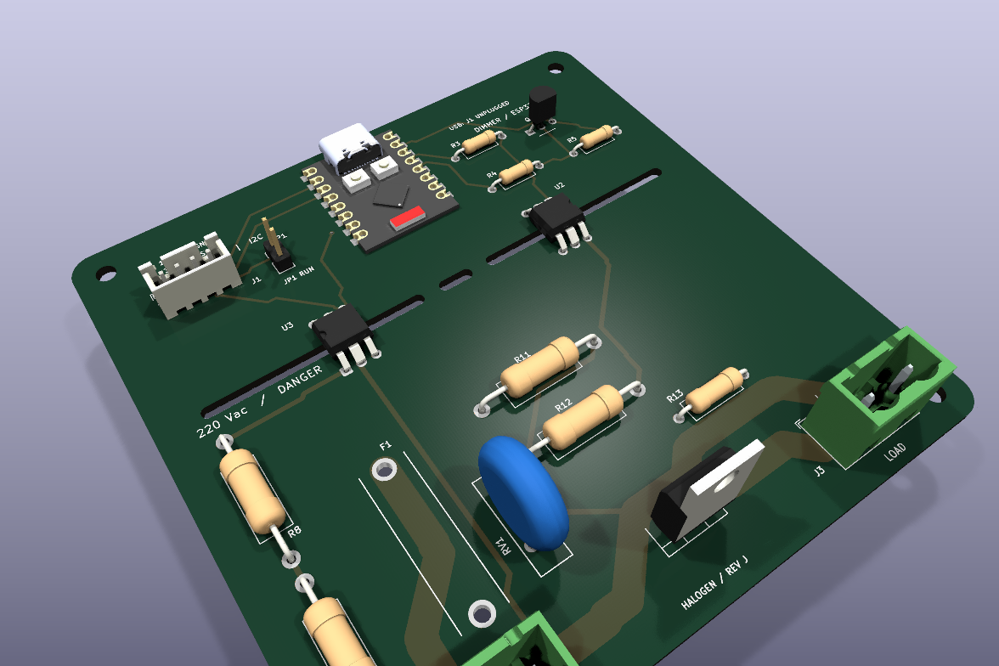
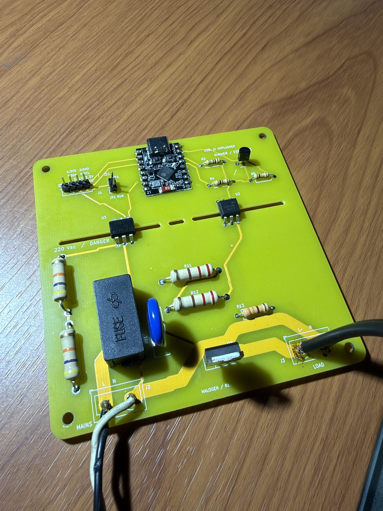

# 220 Vac halogen dimmer

<!-- markdownlint-disable MD013 -->

 

Two-layer 100 x 100 mm phase-control dimmer for a nominal 220 Vac, 50 Hz, 1000 W halogen load.

- It is the lamp dimmer for the panel bench. It lights the PV panels.
- An ESP32-C3 SuperMini controls it. The ESP32-C3 is an I2C slave.
- The Pico on the main board is the I2C master. The link document is planned: `docs/hardware_v1/dimmer_link.md`.
- A MOC3052M gives random-phase optical triggering.
- An H11AA1 detects the zero crossings.
- A BTA16-800BW switches the load.

## SELV connector J1

The ESP32-C3 gets its 3.3 V power and its I2C bus from J1 (SELV side).

| Pin | Signal |
| --- | ------ |
| 1 | 3V3 in |
| 2 | GND |
| 3 | SDA |
| 4 | SCL |

## Files

- [KiCad project](esp32_dimmer.kicad_pro)
- [Schematic PDF](docs/schematic.pdf)
- [BOM CSV](docs/BOM.csv)
- [Revision notes](docs/REVISION_J.md)
- [Zero-cross calculations](docs/ZERO_CROSS_CALCULATION.md)
- [Design calculations](docs/DESIGN_CALCULATIONS.md)
- [Fabrication requirements](docs/PCB_FABRICATION.md)
- `libraries/` - project-local symbols, footprints and 3D model
- `../shared/` - ESP32-C3 SuperMini symbol, footprint and 3D model

The firmware is in `firmware/esp32c3-dimmer/` (separate change).

## Origin

The design comes from [pcbs_llm_driven_design](https://github.com/fborello-lambda/pcbs_llm_driven_design). The generator scripts stay in that repository.

## Safety

This board switches lethal mains voltage and is not certified. It must not be treated as safe solely because ERC and DRC pass. Preserve the isolation slot and explicit MAINS/SELV constraints, and independently review creepage, clearance, fuse coordination, thermal performance, component ratings, enclosure, and fabrication capability before energizing it.
