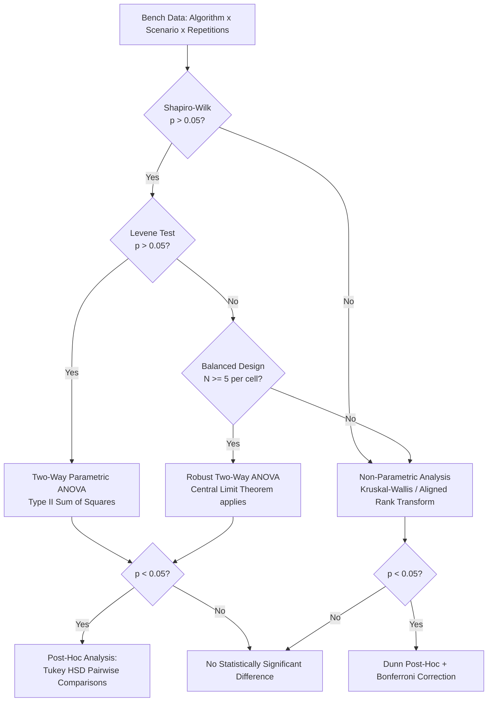

# Two-Way ANOVA for Comparing MPPT Algorithms

Design document for implementing a two-factor analysis of variance in the
comparison harness and experimental benchmark. The goal is to determine whether
the performance differences observed between the five MPPT algorithms are
**statistically significant**, and whether they depend on the operational scenario
(algorithm × condition interaction).

---

## 1. Why an ANOVA is Needed

A single run per algorithm provides only a point estimate, not a distribution.
Without formal statistical testing, we cannot rigorously claim in a paper or thesis
that "Algorithm X performs significantly better than Algorithm Y" — only that
"under this specific seed and run, X captured more energy than Y".

The two-way ANOVA answers three critical scientific questions:

1. **Main effect A (Algorithm):** Is there a statistically significant difference
   between at least one pair of algorithms, averaged across all test scenarios?
2. **Main effect B (Condition / Scenario):** Does the environmental scenario
   (single peak, partial shading, dynamic dimming) significantly affect tracking
   performance?
3. **Interaction A×B (Algorithm × Scenario):** Does an algorithm's relative
   advantage depend on the condition? (e.g. P&O is competitive under uniform full
   sun but degrades under partial shading — this is a direct interaction effect).

---

## 2. Experimental Design

### 2.1. Factors and Levels

| Factor | Type | Levels | Description |
|---|---|---|---|
| **Factor A — Algorithm** | Between-subjects | 5 levels | `P&O`, `InCond`, `Fuzzy`, `Scan&Track`, `PSO` |
| **Factor B — Scenario** | Within-subjects / Environmental | 3 levels | Defined below (§2.2) |

> [!IMPORTANT]
> The design is a **full factorial**: every combination of (Algorithm × Scenario)
> is executed with $N \ge 5\text{ to }10$ repetitions.

### 2.2. The Three Benchmark Scenarios (Factor B)

To directly align with the experimental bench campaign, Factor B is defined by the
three physical scenarios:

| Level | Scenario Name | Physical Setup | What It Tests |
|---|---|---|---|
| **B₁** | **Uniform Steady (Single Peak)** | Both panels @ $90^\circ$, constant lamp power | Baseline steady-state efficiency ($\eta_{ss}$), lock-on speed ($T_c$), and voltage ripple ($\Delta V_{pp}$). |
| **B₂** | **Static Partial Shading (Multi-Peak)** | Panel A @ $90^\circ$, Panel B @ $45^\circ$, constant lamp power | Susceptibility to local-maximum traps ($D_{trap}$), global search capability, and GMPP hit rate ($HR_{GMPP}$). |
| **B₃** | **Dynamic Dimming Profile (Staircase)** | Repeatable stepped dimming: $100\% \to 60\% \to 30\% \to 100\%$ (5–10 s plateaus) | Dynamic energy efficiency ($\eta_E$), re-acquisition time ($T_{reacq}$), plateau traps, and restart policy trigger accuracy. |

### 2.3. Dependent Variables

A separate two-way ANOVA can be computed for each primary metric of interest:

| Metric | Symbol | Type | Primary Role in ANOVA |
|---|:---:|---|---|
| **Dynamic Energy Efficiency** | $\eta_E$ (or $\eta_{ss}$ for B₁/B₂) | Continuous, $[0, 1]$ | **Primary Headline Metric** |
| **Normalized RMSE** | $nRMSE$ | Continuous, $\ge 0$ | Steady-state tracking precision |
| **Transient Energy Loss** | $E_{loss}$ | Continuous, $\ge 0$ | Search transient penalty (Joules) |
| **Convergence / Re-acquisition Time** | $T_c$ / $T_{reacq}$ | Continuous, $\ge 0$ | Transient responsiveness |

> [!WARNING]
> The GMPP hit rate ($HR_{GMPP}$) is a **proportion** / binary outcome (success/trap).
> An ANOVA on raw proportions violates normality assumptions. For $HR_{GMPP}$, use
> a logistic regression model (generalized linear model with logit link) or Fisher's
> exact test across algorithms.

### 2.4. Sources of Repetitions ($N \ge 5\text{ to }10$)

To satisfy ANOVA variance requirements, each cell must have genuine variability:

| Algorithm Class | Mechanism for Generating Repetitions |
|---|---|
| **Stochastic (PSO)** | Vary RNG seed: $\text{seed} \in \{0, 1, \dots, N-1\}$. |
| **Local Trackers (P&O, InCond, Fuzzy)** | Vary starting duty: $D_0 \in \{0.20, 0.25, 0.35, 0.45, 0.50\}$ + natural bench electrical sensor noise. |
| **Deterministic Global (Scan&Track)** | Repeated runs across the physical profile with bench electrical sensor noise and slight lamp thermal drift. |

---

## 3. Data Pipeline & Verification of Assumptions

### 3.1. Assumptions Check

Before running the parametric ANOVA, the pipeline verifies:

1. **Normality of Residuals:** Shapiro-Wilk test (`scipy.stats.shapiro`) on model residuals.
2. **Homoscedasticity (Equal Variances):** Levene's test (`scipy.stats.levene`) across groups.



### 3.2. Execution with `statsmodels`

```python
import statsmodels.api as sm
from statsmodels.formula.api import ols
from statsmodels.stats.multicomp import pairwise_tukeyhsd

# Two-way ANOVA with Type II Sum of Squares (appropriate for factorial designs)
model = ols('eta ~ C(algorithm) * C(scenario)', data=df).fit()
anova_table = sm.stats.anova_lm(model, typ=2)

# Post-hoc pairwise comparison (Tukey HSD)
tukey = pairwise_tukeyhsd(df['eta'], df['algorithm'], alpha=0.05)
```

---

## 4. Visualisation for Papers & Thesis

The script generates:
1. **Interaction Plot:** Mean $\eta$ versus Scenario for each of the 5 algorithms. Non-parallel lines visually demonstrate the Algorithm × Scenario interaction.
2. **Boxplots per Cell:** Distribution of $\eta$ showing spread, median, and outliers across the $5 \times 3 = 15$ cells.
3. **Tukey HSD Significance Heatmap:** Pairwise matrix highlighting which algorithms differ significantly ($p < 0.05, p < 0.01, p < 0.001$).

---

## 5. Location and Execution

```
harness/
├── compare_anova.py          # Main script: processes data & computes ANOVA
├── output/
│   ├── anova_data.csv        # Cleaned dataset (algorithm, scenario, rep, eta, nrmse)
│   ├── anova_table.csv       # Standard ANOVA table (SS, df, MS, F, p-value)
│   ├── anova_interaction.png # Interaction & box plots
│   └── anova_tukey.csv       # Pairwise post-hoc comparisons
```

Execute with:
```bash
uv run harness/compare_anova.py
```

---

## 6. References

- Montgomery, D.C. (2017). *Design and Analysis of Experiments*, 9th ed. Wiley.
- Yang, B. et al. (2023). *State-of-the-art review of MPPT techniques for hybrid PV-TEG systems.* Global Energy Interconnection, 6(5), 567–591. (Table 4 uses ANOVA for algorithm benchmarking).
- [metrics_analysis.md](metrics_analysis.md) — Detailed formulation of metrics.
- [metrics_summary.md](metrics_summary.md) — Complete metrics catalogue and selection.
